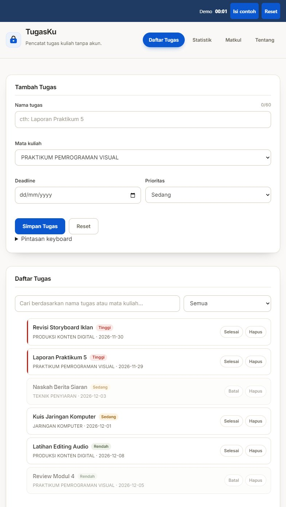
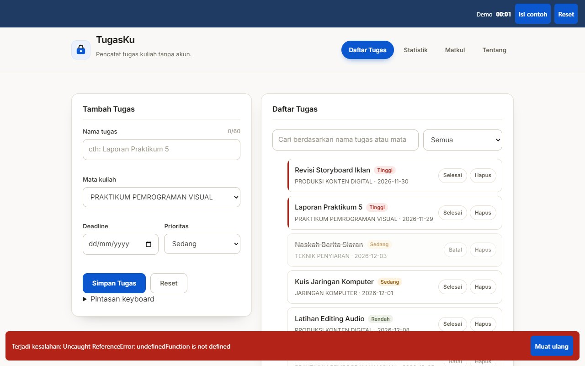
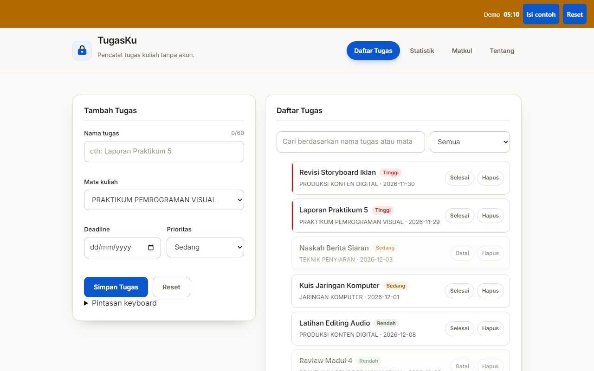
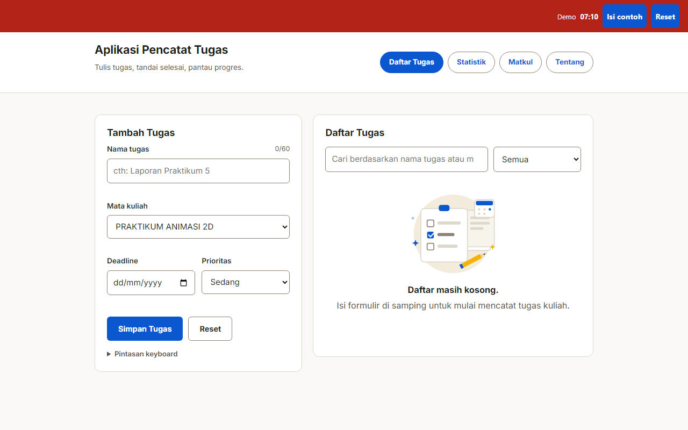

# Laporan Persiapan Demo Akhir (P14)

| | |
|---|---|
| Nama | Iqgam Afrizal |
| NRP | 5125500042 |
| Kelas | 3 D3 MM B |
| Mata kuliah | Praktikum Pemrograman Visual (TB033109) |
| Dosen pengampu | Aji Sapta Pramulen, S.T., M.T. |
| Tanggal | 27 November 2026 |

## 1. Ringkasan tugas

Demo akhir menilai prototipe yang saya buat sejak P09 sebagai produk digital.
Penilaian utamanya bukan slide, melainkan aplikasi yang dipakai langsung di
depan kelas. Dari lembar tugas saya menangkap empat tuntutan:

1. Demo berjalan 5-7 menit dan selalu dimulai dari data contoh yang sama.
2. Satu bagian kode ditunjukkan dan alasannya dijelaskan.
3. Hasil uji usability disampaikan dengan angka, dan sejarah sprint dibuktikan
   dari repositori.
4. Ada jawaban teknis untuk pertanyaan "apa yang rusak kalau penggunanya seribu
   orang?".

Karena itu pekerjaan yang saya lakukan dibagi menjadi dua: memasang kit demo
pada aplikasi, lalu menyiapkan bahan demo dan bukti ujinya.

## 2. Yang saya kerjakan

### 2.1 Memasang kit demo

Berkas `demo-kit.js` dari lampiran saya salin ke akar proyek, lalu di
`index.html` saya tulis pengaturan `window.DEMO_KIT` sebelum kit dimuat dan
sebelum `src/js/main.js`:

```js
window.DEMO_KIT = {
  kunciStorage: ['tugasku:tugas:v1', 'tugasku:matkul:v1'],
  isiContoh() {
    const tanggal = (n) => {
      const d = new Date();
      d.setDate(d.getDate() + n);
      return `${d.getFullYear()}-${String(d.getMonth() + 1).padStart(2, '0')}-${String(d.getDate()).padStart(2, '0')}`;
    };
    localStorage.setItem('tugasku:tugas:v1', JSON.stringify([
      { id: 1, nama: 'Laporan Praktikum 5', mk: 'PRAKTIKUM PEMROGRAMAN VISUAL', deadline: tanggal(1), prio: 'Tinggi', done: false },
      // ... lima tugas lain
    ]));
    localStorage.setItem('tugasku:matkul:v1', JSON.stringify([
      'PRAKTIKUM PEMROGRAMAN VISUAL', 'PRODUKSI KONTEN DIGITAL', 'JARINGAN KOMPUTER',
      'TEKNIK PENYIARAN', 'ANIMASI 2D', 'JURNALISTIK',
    ]));
  },
};
```

Ada tiga keputusan yang saya ambil saat mengisi konfigurasi.

1. **Kunci harus sama dengan `src/js/storage.js`.** Aplikasi memakai kunci
   berversi `tugasku:tugas:v1` dan `tugasku:matkul:v1`. Kalau saya menulis kunci
   lain, tombol Isi contoh akan terlihat berhasil tetapi daftar tetap kosong.
   Kunci yang sama juga dipakai `kunciStorage`, jadi tombol Reset benar-benar
   menghapus data demo.
2. **Deadline dihitung dari hari ini, bukan ditulis mati.** Validasi aplikasi
   menolak deadline yang sudah lewat. Dengan `tanggal(1)`, `tanggal(2)`, dan
   seterusnya, data contoh tetap sah dipakai di hari demo, kapan pun harinya.
3. **Data contoh sengaja berisi tugas selesai dan belum selesai.** Enam tugas
   dengan dua selesai membuat halaman Statistik langsung menunjukkan 33%, jadi
   fitur statistik bisa didemokan tanpa mengubah data dulu.

### 2.2 Menyesuaikan posisi panel demo

Panel bawaan kit muncul di kanan atas dan menutup tombol navigasi Statistik,
Matkul, dan Tentang. Saya menambahkan tiga baris CSS di `src/css/style.css`
supaya panel menjadi bilah penuh di atas halaman dan isi aplikasi bergeser ke
bawah:

```css
#demo-kit-panel{top:0 !important;bottom:auto !important;left:0 !important;right:0 !important;border-radius:0 !important;justify-content:flex-end;padding:8px 16px !important}
body:has(#demo-kit-panel){padding-top:60px}
body:has(#demo-kit-panel) .topbar{top:60px}
```

Hasilnya terlihat pada gambar berikut. Tombol navigasi tetap bisa diklik dan
tombol Simpan Tugas tidak tertutup.



## 3. Cara menjalankan dan melatih demo

1. Jalankan server lokal dari folder proyek (`jalankan.bat`, atau
   `python -m http.server 5500`).
2. Buka `http://127.0.0.1:5500/?demo=1`.
3. Tekan **Isi contoh**. Halaman memuat ulang dan menampilkan 6 tugas, 2 di
   antaranya sudah selesai.
4. Latih demo sambil melihat pengatur waktu. Warna panel berubah oranye pada
   menit ke-5 dan merah pada menit ke-7.
5. Tekan **Reset** setelah latihan supaya demo di kelas dimulai dari keadaan
   yang sama.

Tanpa `?demo=1` panel tidak muncul dan aplikasi berjalan seperti pemakaian
biasa. Kalau setelah mengganti berkas tampilan masih terlihat lama, tekan
`Ctrl` + `F5` sekali.

## 4. Hasil uji kit demo

| No | Skenario | Yang diharapkan | Hasil |
|---|---|---|---|
| U1 | Buka `http://127.0.0.1:5500/` tanpa `?demo=1` | Panel tidak muncul, aplikasi normal | Lolos. Panel tidak ada, daftar kosong, Console bersih. |
| U2 | Buka `?demo=1` | Panel muncul dengan waktu `00:00` | Lolos. Panel tampil, tombol Isi contoh dan Reset aktif. |
| U3 | Tekan Isi contoh | 6 tugas, 2 selesai, statistik 33% | Lolos. Kunci `tugasku:tugas:v1` dan `tugasku:matkul:v1` terisi, id unik 1-6. |
| U4 | Tambah satu tugas dari formulir | Tugas baru muncul, statistik berubah | Lolos. Jumlah menjadi 7, statistik 29%, toast "Tugas disimpan.", Console bersih. |
| U5 | Tekan Reset | Data contoh hilang, aplikasi kembali ke keadaan awal | Lolos. Kedua kunci terhapus, daftar 0 tugas, pilihan mata kuliah kembali ke 12 mata kuliah bawaan. |
| U6 | Sengaja memicu kesalahan (`undefinedFunction()` lewat `setTimeout`) | Pesan jelas muncul, error tetap tercatat di Console, aplikasi bisa dipulihkan | Lolos. Muncul "Terjadi kesalahan: Uncaught ReferenceError: undefinedFunction is not defined", Console tetap mencatat error yang sama, tombol Muat ulang mengembalikan aplikasi dengan 6 tugas utuh. |

Bukti uji kesalahan:



Catatan: perubahan warna panel pada menit ke-5 dan ke-7 saya uji dengan Chrome
tanpa jendela (*headless*) memakai waktu virtual, bukan dengan menunggu tujuh
menit. Hasilnya panel berwarna oranye pada 05:10 dan merah pada 07:10, sesuai
ambang 300 dan 420 detik di kit.





## 5. Skenario demo 5-7 menit

| Waktu | Isi | Alat bantu |
|---|---|---|
| 00:00-00:30 | Masalah: deadline tersebar di chat kelas, kertas, dan chat pribadi. | Slide 1 |
| 00:30-02:30 | Alur utama: buka `?demo=1`, Isi contoh, tunjukkan 6 tugas dan statistik 33%, tambah satu tugas, tandai selesai, buka Statistik. | Aplikasi |
| 02:30-03:30 | Cari dan saring: cari "jaringan", saring "Belum selesai" dan "Prioritas Tinggi". | Aplikasi |
| 03:30-04:30 | Keadaan tidak ideal: kosongkan nama lalu Simpan (pesan validasi), isi deadline lampau, hapus satu tugas lewat modal konfirmasi. | Aplikasi |
| 04:30-05:30 | Hasil uji usability dan perbaikannya, lalu sejarah sprint dari repositori. | Slide + GitHub |
| 05:30-06:30 | Satu potongan kode andalan dan jawaban "seribu pengguna". | Editor + slide |
| 06:30-07:00 | Penutup, tautan repositori dan tag `v1.0.0`, sebutkan rekaman cadangan 60 detik. | Slide 1 |

Pengatur waktu kit berubah oranye tepat di menit ke-5, jadi bagian uji
usability harus sudah dimulai saat itu. Merah di menit ke-7 berarti demo sudah
melewati batas.

## 6. Satu bagian kode yang saya banggakan

Bagian yang saya pilih adalah `src/js/storage.js`, khususnya fungsi `baca()`.
Modul ini adalah satu-satunya tempat yang menyentuh `localStorage`.

```js
function baca(kunci, kunciLama, saring, cadangan) {
  let isi;
  try {
    isi = localStorage.getItem(kunci);
  } catch {
    pesan = PESAN_BLOKIR;
    return cadangan;
  }
  // ... migrasi kunci lama dan penyaringan data
  try {
    const mentah = JSON.parse(isi);
    const data = saring(mentah);
    pesan = Array.isArray(mentah) ? '' : 'Data tersimpan rusak dan diabaikan.';
    return data;
  } catch {
    pesan = 'Data tersimpan rusak dan diabaikan.';
    return [];
  }
}
```

Alasannya:

1. **Satu pintu.** Semua baca-tulis data lewat modul ini, jadi aturan
   penyimpanan tidak tersebar di banyak berkas.
2. **Tidak pernah melempar galat.** JSON rusak, data bukan array, atau
   penyimpanan diblokir hanya menghasilkan daftar kosong dan pesan ke pengguna.
   Aplikasi tetap terbuka.
3. **Kunci berversi dan migrasi.** Data lama di kunci `tugas`/`matkul`
   dipindahkan sekali ke kunci `v1`, lalu kunci lama dihapus.
4. **Mudah diganti saat data pindah ke server.** Karena hanya modul ini yang
   tahu cara menyimpan, untuk seribu pengguna saya cukup mengganti isi modul
   dengan panggilan API tanpa membongkar `state.js`, `ui.js`, dan `main.js`.

## 7. Hasil uji usability dan perbaikan

Uji yang sudah tercatat ada di laporan Tugas 4, dengan dua penguji: Fara dan
Nio, pada 10 Oktober 2026. Pengujian dilakukan dengan memberikan aplikasi lalu
meminta penguji menambah dan menyelesaikan satu tugas tanpa didampingi.

| ID | Temuan | Angka | Perbaikan | Uji ulang |
|---|---|---|---|---|
| U-01 | Fara mengira menu "Daftar" adalah pendaftaran akun. | 1 dari 2 penguji, 40 detik berhenti di menu | Label navigasi diganti menjadi "Daftar Tugas" | Langsung paham tanpa bertanya |
| U-02 | Nio sulit membedakan prioritas Tinggi dan Sedang saat tugas banyak. | 1 dari 2 penguji, 50 detik mencari | Daftar diurutkan prioritas Tinggi di atas, diberi garis merah | Tugas Tinggi ditemukan tanpa mencari |

Charter menargetkan 3 pengguna dengan minimal 2 berhasil menambah lalu
menandai selesai tanpa dibantu. Uji P14 dengan 3 pengguna **belum saya
lakukan**, jadi angka itu belum bisa saya klaim. Protokol, tugas yang dibacakan,
dan formulir pencatatannya sudah saya siapkan di `docs/UJI_USABILITY_P14.md`;
satu sesi uji memakan waktu sekitar 15 menit untuk tiga orang. Setelah uji,
angka rekapnya tinggal dimasukkan ke tabel di atas dan ke slide 6.

## 8. Sejarah sprint dari repositori

Repositori: <https://github.com/sayarizal501/ppv-project-akhir-5125500042>

| Sprint | Rencana di ROADMAP | Terealisasi | Bukti |
|---|---|---|---|
| P10 | Perbaiki bug, tangani data rusak, commit `fix:` dan merge cabang | Selesai | `fix/font-path` (125f308), `fix/localstorage-rusak` (26b86fc), `docs/DEBUG_LOG.md` |
| P11 | Pecah `app.js` menjadi ES Modules, hapus variabel global | Selesai | Commit 5e2d54d sampai 3719232, merge `refactor/modul` (fe57af5) |
| P12 | Komponen `BarisTugas`, penyimpanan aman, changelog, tag | Selesai | `1fde1ae`, `d1ad2c3`, tag `v0.4.0` |
| P13 | Konsep produk dan dua mockup | Sebagian | `docs/konsep/` selesai, mockup halaman utama dan halaman fitur belum |
| P14 | Uji 3 pengguna, perbaikan temuan, demo lancar, repo bersih | Demo siap | Kit demo, laporan, 10 slide, rekaman 60 detik, tag `v1.0.0` |

Hal yang belum selesai:

- Uji 3 pengguna P14 belum dijalankan. Protokol dan formulirnya sudah siap di
  `docs/UJI_USABILITY_P14.md`; tinggal dicari tiga peserta.
- Mockup P13 belum dikerjakan, jadi klaim "P13 selesai" tidak saya pakai.

## 9. Jawaban "apa yang rusak kalau penggunanya seribu orang?"

Yang rusak lebih dulu bukan halaman webnya, tetapi lapisan datanya.
`localStorage` menyimpan data di satu peramban di satu perangkat. Seribu
pengguna berarti seribu salinan data yang terpisah: tidak ada sinkronisasi
antar perangkat, tidak ada cadangan, dan data hilang kalau pengguna membersihkan
data peramban atau memakai mode privat. Kuota `localStorage` juga kecil
(sekitar 5 MB per origin), jadi daftar tugas dan mata kuliah yang panjang bisa
gagal disimpan. Belum ada login, sehingga tidak ada cara mengetahui data itu
milik siapa.

Rencana mengatasinya:

1. Pindahkan data ke server: API + basis data, dengan `storage.js` diganti
   menjadi pemanggil API. Modul lain tidak perlu diubah karena hanya
   `storage.js` yang tahu cara menyimpan.
2. Tambahkan autentikasi dan kepemilikan data per pengguna.
3. Tambahkan ekspor/impor JSON sebagai cadangan pengguna. Fitur ini sudah
   berstatus Should di charter tetapi belum dikerjakan.
4. Simpan salinan Bootstrap secara lokal agar demo tidak bergantung pada CDN.

Halaman statis sendiri tetap bisa melayani seribu pengguna; yang tidak siap
adalah penyimpanan dan sinkronisasinya.

## 10. Rencana cadangan

- Rekaman layar 60 detik berisi alur utama dari Isi contoh sampai Statistik:
  `docs/video/demo-cadangan-60detik.mp4` (1280x800, H.264, 60 detik). Direkam
  otomatis dengan Chrome dan Playwright, lalu dipotong memakai ffmpeg.
- Menjalankan aplikasi dari server lokal sebelum masuk kelas, bukan membuka
  `index.html` lewat klik dua kali (ES Modules tidak jalan di `file://`).
- Menyimpan PDF slide, rekaman, dan repositori di satu folder yang sama.
- Kalau internet kelas bermasalah, Bootstrap di CDN bisa diganti salinan lokal
  di `assets/vendor`; langkah ini belum dikerjakan.

## 11. Daftar periksa pengumpulan

| Butir | Status |
|---|---|
| `demo-kit.js` terpasang dan `DEMO_KIT.isiContoh` terisi | Selesai |
| Isi contoh, Reset, dan spanduk kesalahan diuji | Selesai |
| Panel demo tidak menutup navigasi | Selesai |
| Warna timer menit ke-5 dan ke-7 | Selesai (uji waktu virtual) |
| Rekaman cadangan 60 detik | Selesai, `docs/video/demo-cadangan-60detik.mp4` |
| Slide 10 halaman | Selesai, `docs/slide-demo-akhir.pdf` |
| Commit akhir dan tag `v1.0.0` | Selesai |
| Uji 3 pengguna P14 dengan angka | Belum, protokol siap di `docs/UJI_USABILITY_P14.md` |
| PDF bernama `5125500042_Iqgam Afrizal_PPV_DemoAkhir.pdf` | Selesai, ada di folder induk proyek |
| Tautan repositori dan tag final di slide pertama | Sudah ada di slide 1 |

## 12. Berkas yang berubah

| Berkas | Perubahan |
|---|---|
| `demo-kit.js` | Berkas baru dari lampiran tugas |
| `index.html` | Pengaturan `window.DEMO_KIT`, pemuatan kit sebelum `main.js` |
| `src/css/style.css` | Panel demo menjadi bilah atas agar tidak menutup navigasi |
| `docs/screenshots/demo-kit.jpeg` | Bukti panel demo dan data contoh |
| `docs/screenshots/demo-kit-error.jpeg` | Bukti spanduk kesalahan dan tombol Muat ulang |
| `docs/screenshots/timer-5menit.png`, `timer-7menit.png` | Bukti warna panel pada menit ke-5 dan ke-7 |
| `docs/screenshots/proyek-daftar-p14.png`, `proyek-statistik-p14.png` | Tangkapan layar untuk slide |
| `docs/LAPORAN_DEMO_AKHIR.md` | Laporan ini |
| `docs/UJI_USABILITY_P14.md` | Protokol dan formulir uji 3 pengguna |
| `docs/slide-demo-akhir.html` | Sumber slide 10 halaman |
| `docs/slide-demo-akhir.pdf` | PDF slide untuk dikumpulkan |
| `docs/video/demo-cadangan-60detik.mp4` | Rekaman cadangan alur utama |
| `CHANGELOG.md` | Catatan rilis `1.0.0` |
| `README.md` | Petunjuk menjalankan mode demo |
| `docs/ROADMAP.md` | Status P14 |
